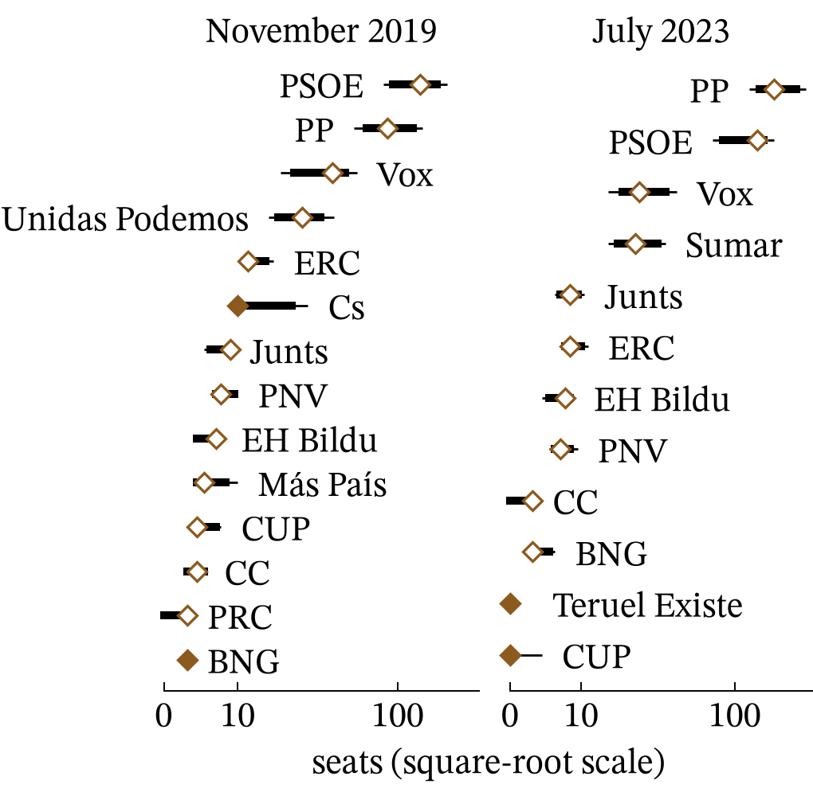

# What is one vote worth? Spain, 29 November 2026

A seat simulation of Spain's general election of 29 November 2026, built to answer one
question: how likely is one more vote to change the result? Every list is treated alike, the
two blocs come only from how deputies voted in 2023, and nothing here advises anyone how, or
whether, to vote.

Polls with fieldwork ending 27 October – 10 November 2026 (16 firms, 19 days before the
election); 100,000 simulated elections (seed `20261129`).

| One more vote, for the average voter | Probability | 95% Monte Carlo interval |
|---|---:|---:|
| changes a seat | 1 in 76,000 | 1 in 76,000 – 77,000 |
| changes whether either bloc reaches 176 seats | 1 in 10.8 million | 1 in 10.2 million – 11.3 million |
| … F reaching 176 | 1 in 18 million | 1 in 16.9 million – 19.3 million |
| … S reaching 176 | 1 in 22.8 million | 1 in 21.2 million – 24.6 million |
| … S without Junts reaching 176 | 1 in 45.2 million | 1 in 41.2 million – 50.2 million |

For scale: picking all six numbers of 49 is 1 in 14 million (13,983,816 combinations), and
Gelman, Silver and Edlin (2012) put the chance that one vote decided the 2008 US presidency at
about 1 in 60 million for the average voter: the Spanish majority figure here is about 6
times larger.

The Monte Carlo intervals only measure simulation noise. The real uncertainty is in the model:
the bandwidth choice moves the answers by 0.2% (seat) and 3.2% (majority), and wider poll
errors, a different swing model or different blocs would move them more (see
[Limits](#limits)).


The carousel summarises it in paper form, one idea per page, in type sized for a phone (see
[Type size](#type-size)): [in Spanish](carousel/carousel.pdf) (the one posted;
[plain text](carousel/slides.txt)) and [in English](carousel/en/carousel.pdf)
([plain text](carousel/en/slides.txt)).

## The question

Spain elects 350 deputies in 52 constituencies by D'Hondt, with a 3% threshold of valid votes
in each; Ceuta and Melilla elect one each. One more vote matters if it moves a seat from one
list to another, and more if that seat moves a bloc across 176, the absolute majority that a
candidate needs in the first investiture vote (Constitution, art. 99.3; 48 hours later a
simple majority is enough).

**Blocs.** To avoid placing any party by judgement, the blocs are the yes votes of the two
investiture votes of the 2023 legislature:

- **F**: Feijóo, 27 September 2023, 172 yes: PP 137, Vox 33, UPN 1, CC 1.
- **S**: Sánchez, 16 November 2023, 179 yes: PSOE 121, Sumar 31, ERC 7, Junts 7, EH Bildu 6,
  PNV 5, BNG 1, CC 1.

The totals are those recorded in the Diario de Sesiones
([27 Sep 2023](https://www.congreso.es/public_oficiales/L15/CONG/DS/PL/DSCD-15-PL-5.PDF),
[16 Nov 2023](https://www.congreso.es/public_oficiales/L15/CONG/DS/PL/DSCD-15-PL-8.PDF)); the
transcript gives totals only, and the split by party above adds up to them. Frente Amplio and
Podemos, the two 2026 lists that share Sumar's 2023 vote, count in S; Coalición Canaria voted
yes both times, so it counts in both; lists without a seat in 2023 count in neither. S without
Junts is reported too.

**The average voter.** Each constituency's probability for each list, averaged with weights
equal to the list's expected votes there: the chance for a vote picked at random from all the
votes cast for the modelled lists.

## Results

### Blocs and lists

<!-- BEGIN blocs -->
| Bloc | Mean seats | 80% | 95% | P(≥ 176) | One vote moves it across 176: 1 in |
| --- | ---: | :---: | :---: | ---: | ---: |
| F | 202 | 181–224 | 169–236 | 94.2% | 18 million |
| S | 146 | 125–168 | 113–180 | 4.2% | 22.8 million |
| S without Junts | 141 | 120–163 | 108–175 | 2.3% | 45.2 million |
<!-- END blocs -->


<!-- BEGIN lists -->
| List | Vote share (centre) | Mean seats | 80% | 95% | P(at least one seat) |
| --- | ---: | ---: | :---: | :---: | ---: |
| PP | 32.1% | 133 | 110–157 | 98–169 | 100% |
| PSOE | 26.4% | 104 | 83–126 | 72–138 | 100% |
| Vox | 19.4% | 68 | 50–88 | 41–99 | 100% |
| Frente Amplio | 7.0% | 13 | 8–19 | 6–24 | 100% |
| ERC | 2.4% | 9 | 7–13 | 6–15 | 100% |
| EH Bildu | 1.4% | 7 | 5–9 | 3–11 | 100% |
| Junts | 1.4% | 5 | 3–8 | 2–8 | 100% |
| PNV | 0.91% | 4 | 2–6 | 2–6 | 100% |
| BNG | 0.91% | 3 | 2–5 | 1–6 | 99% |
| Adelante Andalucía | 1.4% | 2 | 0–4 | 0–7 | 87% |
| Podemos | 1.9% | 1 | 0–2 | 0–2 | 82% |
| CC | 0.40% | 1 | 1–1 | 0–3 | 91% |
| SALF | 1.7% | 0 | 0–0 | 0–1 | 6% |
| Soria ¡Ya! | 0.04% | 0 | 0–0 | 0–0 | 1% |
| Teruel Existe | 0.04% | 0 | 0–0 | 0–0 | 0.01% |
<!-- END lists -->

"Vote share (centre)" is the share the simulation is centred on: the poll median for polled
lists, rescaled with the unpolled lists and blank votes; Teruel Existe and Soria ¡Ya! keep
their 2023 share.

### Constituencies

Small constituencies weigh more per elector: 35,000 electors per seat in Teruel against
150,000 in Madrid, 4.1 times as many. Across constituencies the chance of changing a seat
varies 12-fold, and the chance of changing the majority 56-fold: in Ceuta, a one-seat race,
one vote changes the seat with probability 1 in 10,000 and the majority 1 in 740,000; in
Soria, where the seats at stake rarely move a bloc across 176, the majority odds are 1 in 41.4
million.


Every constituency, sorted by the chance of changing a seat:

<!-- BEGIN provinces -->
| Constituency | Seats | Electors per seat | Seat: 1 in | Either bloc to 176: 1 in | F: 1 in | S: 1 in | S without Junts: 1 in |
| --- | ---: | ---: | ---: | ---: | ---: | ---: | ---: |
| Ceuta | 1 | 66,000 | 10,000 | 740,000 | 1.2 million | 1.6 million | 2.5 million |
| Soria | 2 | 39,000 | 18,000 | 41.4 million | 103.6 million | 69.1 million | — |
| Ávila | 3 | 46,000 | 21,000 | 38.7 million | 45.6 million | 256.3 million | 53.2 million |
| Segovia | 3 | 40,000 | 21,000 | 10 million | 18.6 million | 21.6 million | 31.8 million |
| Teruel | 3 | 35,000 | 22,000 | 3.8 million | 5.2 million | 12.5 million | 7.5 million |
| Zamora | 3 | 54,000 | 25,000 | 5.5 million | 10 million | 12 million | 23.6 million |
| Palencia | 3 | 46,000 | 25,000 | 2.4 million | 4.5 million | 4.4 million | 9.3 million |
| Lleida | 4 | 82,000 | 28,000 | 7.1 million | 11.7 million | 17.9 million | 26.7 million |
| Huesca | 3 | 59,000 | 33,000 | 2.7 million | 4.6 million | 5.7 million | 15.2 million |
| Álava | 4 | 67,000 | 36,000 | 6.2 million | 10.3 million | 13.7 million | 21 million |
| Cuenca | 3 | 50,000 | 38,000 | 3.6 million | 6.9 million | 7.1 million | 13 million |
| Girona | 6 | 96,000 | 38,000 | 6.2 million | 10.3 million | 13.8 million | 23.3 million |
| La Rioja | 4 | 65,000 | 40,000 | 6.8 million | 13.1 million | 12.7 million | 38.2 million |
| Tarragona | 6 | 100,000 | 51,000 | 6.7 million | 13.1 million | 12.6 million | 30.2 million |
| Cáceres | 4 | 85,000 | 57,000 | 7.7 million | 12.3 million | 14.1 million | 71.3 million |
| Burgos | 4 | 75,000 | 59,000 | 6.2 million | 11.7 million | 12.6 million | 24.5 million |
| Castellón | 5 | 90,000 | 60,000 | 8.0 million | 12.3 million | 18.2 million | 41.4 million |
| Gipuzkoa | 6 | 100,000 | 61,000 | 23.8 million | 34.6 million | 72.2 million | 132.7 million |
| Almería | 6 | 90,000 | 62,000 | 12.5 million | 23.7 million | 24.3 million | 32.6 million |
| Navarra | 5 | 110,000 | 62,000 | 12.3 million | 20.6 million | 27.5 million | 25 million |
| Huelva | 5 | 82,000 | 62,000 | 12.9 million | 23.2 million | 25 million | 23.9 million |
| Lugo | 4 | 85,000 | 63,000 | 4.9 million | 8.0 million | 12.6 million | 20.9 million |
| Ourense | 4 | 90,000 | 64,000 | 4.8 million | 8.5 million | 10 million | 28.9 million |
| Ciudad Real | 5 | 79,000 | 65,000 | 13.5 million | 18.2 million | 35.4 million | 57.8 million |
| S. C. Tenerife | 7 | 130,000 | 71,000 | 9.8 million | 17 million | 20.2 million | 48.9 million |
| Baleares | 8 | 110,000 | 71,000 | 7.8 million | 13 million | 17.5 million | 47.7 million |
| Córdoba | 6 | 110,000 | 72,000 | 9.3 million | 16.4 million | 16.4 million | 33.8 million |
| Málaga | 11 | 120,000 | 74,000 | 9.0 million | 11.9 million | 32.6 million | 81.8 million |
| Valladolid | 5 | 88,000 | 74,000 | 37.3 million | 54.8 million | 95.8 million | 73.7 million |
| León | 4 | 110,000 | 75,000 | 7.1 million | 12.2 million | 16.5 million | 35.5 million |
| Las Palmas | 8 | 120,000 | 75,000 | 9.1 million | 15.2 million | 19.6 million | 35.9 million |
| Granada | 7 | 110,000 | 76,000 | 8.2 million | 14.3 million | 16.5 million | 112.2 million |
| Toledo | 6 | 95,000 | 76,000 | 13.6 million | 24.2 million | 27.6 million | 43.7 million |
| Cádiz | 8 | 130,000 | 77,000 | 9.9 million | 15.9 million | 22.7 million | 42.5 million |
| Bizkaia | 8 | 120,000 | 81,000 | 19.6 million | 33.2 million | 43.9 million | 70.6 million |
| Albacete | 4 | 77,000 | 81,000 | 5.2 million | 7.7 million | 11.7 million | 23.1 million |
| Salamanca | 4 | 76,000 | 82,000 | 4.5 million | 7.9 million | 9.3 million | 15.3 million |
| Jaén | 5 | 100,000 | 86,000 | 15 million | 33 million | 25.8 million | 35.4 million |
| Guadalajara | 3 | 70,000 | 87,000 | 26.7 million | 38.7 million | 86.4 million | 84.7 million |
| Cantabria | 5 | 100,000 | 87,000 | 20.6 million | 41.5 million | 37.8 million | 202.5 million |
| Zaragoza | 7 | 110,000 | 90,000 | 12.1 million | 19.6 million | 23.9 million | 68.5 million |
| Sevilla | 12 | 130,000 | 91,000 | 12.7 million | 22.8 million | 25.2 million | 60.4 million |
| Alicante | 12 | 110,000 | 92,000 | 11.8 million | 17.6 million | 25.8 million | 39 million |
| Barcelona | 32 | 140,000 | 95,000 | 23 million | 46.8 million | 35.6 million | 61.5 million |
| Asturias | 7 | 140,000 | 95,000 | 10.6 million | 17.8 million | 23.9 million | 39.9 million |
| Melilla | 1 | 64,000 | 97,000 | 13.3 million | 34.9 million | 19.9 million | 11.3 million |
| A Coruña | 8 | 140,000 | 97,000 | 13.9 million | 25.9 million | 28.1 million | 59.2 million |
| Pontevedra | 7 | 130,000 | 98,000 | 14.5 million | 29.2 million | 27 million | 59.8 million |
| Murcia | 10 | 110,000 | 100,000 | 16 million | 26.6 million | 34.3 million | 66.2 million |
| Badajoz | 5 | 110,000 | 110,000 | 14.1 million | 20.7 million | 35 million | 38.2 million |
| Valencia | 16 | 130,000 | 110,000 | 13.8 million | 23.6 million | 28 million | 58.1 million |
| Madrid | 38 | 150,000 | 130,000 | 12.6 million | 19.1 million | 27.3 million | 77.8 million |
<!-- END provinces -->

"—": no such event in the runs. The majority figures of a single constituency rest on few
simulated events and are noisy; the national figures above are precise.

The same numbers, with expected votes, are in
[results/provinces.csv](results/provinces.csv); simulated mean seats by constituency and list
are in [results/seats_by_province.csv](results/seats_by_province.csv).

### Who holds the power

Seat shares are not power. The Shapley–Shubik index (Shapley and Shubik, 1954) is the share of
all orderings of the lists in which a list's seats are the ones that carry a growing coalition
past 176; the Banzhaf index (Banzhaf, 1965) is the share of winning coalitions in which a list
is decisive, normalised to sum to one. Both assume any coalition can form, so they measure
arithmetic leverage, not who will govern.

<!-- BEGIN power -->
The 2023 Congress:

| List | Seats | Seat share | Shapley–Shubik | Banzhaf |
| --- | ---: | ---: | ---: | ---: |
| PP | 137 | 39.1% | 40.6% | 41.5% |
| PSOE | 121 | 34.6% | 20.1% | 17.8% |
| Vox | 33 | 9.4% | 15.0% | 15.8% |
| Sumar | 31 | 8.9% | 12.3% | 13.8% |
| ERC | 7 | 2.0% | 3.1% | 2.8% |
| Junts | 7 | 2.0% | 3.1% | 2.8% |
| EH Bildu | 6 | 1.7% | 2.5% | 2.4% |
| PNV | 5 | 1.4% | 1.6% | 1.6% |
| BNG | 1 | 0.3% | 0.5% | 0.5% |
| CC | 1 | 0.3% | 0.5% | 0.5% |
| UPN | 1 | 0.3% | 0.5% | 0.5% |

Averaged over 10,000 simulated 2026 parliaments (lists with at least 0.1% of the seats):

| List | Mean seat share | Shapley–Shubik | Banzhaf |
| --- | ---: | ---: | ---: |
| PP | 38.0% | 38.4% | 38.1% |
| PSOE | 29.7% | 27.0% | 26.7% |
| Vox | 19.5% | 26.5% | 26.4% |
| Frente Amplio | 3.6% | 2.4% | 2.5% |
| ERC | 2.7% | 1.7% | 1.8% |
| EH Bildu | 2.0% | 1.2% | 1.4% |
| Junts | 1.4% | 0.9% | 1.0% |
| PNV | 1.1% | 0.7% | 0.8% |
| BNG | 0.7% | 0.4% | 0.5% |
| Adelante Andalucía | 0.7% | 0.4% | 0.5% |
| Podemos | 0.3% | 0.2% | 0.2% |
| CC | 0.3% | 0.2% | 0.2% |
<!-- END power -->

### Players and payoffs

| Player | Payoff | Moves | Constraint |
|---|---|---|---|
| Voters | the outcome (B), voting itself (D), minus the cost (C) | vote, abstain, persuade or mobilise others | one vote among millions |
| Parties | votes, office and policy (Strøm, 1990) | platforms, pacts, investiture votes | 176 seats in the first investiture vote, a simple majority in the second |
| Kingmakers: lists whose seats complete a majority | policy concessions, office | the price of their support | worth something only when pivotal (the power table) |
| Pollsters | accuracy, attention | publish estimates | no publication in the five days before the vote (LOREG art. 69.7) |
| Media | audience, influence | frame the race | the same ban on polls |
| EU fiscal rules | debt and deficit paths | — | narrow what any majority can do |

## Why vote at all

With three or more options, no ranking rule meets all of Arrow's (1951) conditions, and
every non-dictatorial rule can reward voting against one's true ranking (Gibbard, 1973;
Satterthwaite, 1975). Spain's rule is given; the question is whether one vote is worth its
cost. In the calculus of voting (Riker and Ordeshook, 1968) a citizen votes when

    R = p·B − C + D > 0

with p the chance of being decisive, B the value of the outcome to the voter, C the cost of
voting and D the value of voting itself. Downs (1957) noted that p is tiny.

**Cost.** At 30 minutes and 10 €/h, C = 5 €.

**Selfish benefit.** With p = 1 in 10.8 million, the majority would have to be worth 53.8
million € to the voter to cover C; for a seat (p = 1 in 76,000), 380,000 €.

**Social benefit.** If B counts the effect on everyone (Edlin, Gelman and Kaplan, 2007),
B = N·b·α, with N = 49.9 million residents (INE, 1 October 2026, provisional), b the average
gain per person and α the weight the voter gives a stranger relative to themself. Then
p·N = 4.6 for the majority: with b = 100 €, voting pays once α passes 1.1% (about 1 in 93);
with b = 1,000 €, once it passes 0.11%. For a seat, p·N = 650.


**Others' votes.** Persuasion has, on average, no measurable effect in general elections
(Kalla and Broockman, 2018). Mobilisation does have effects: in a US field experiment, a
mailing that showed neighbours each other's turnout raised it by 8.1 points (Gerber, Green
and Larimer, 2008). Those are US estimates; there is no Spanish estimate here. Taking an
assumed 0.1 to 1.0 extra voters per hour of effort, an hour beats 10 €/h only if the majority
is worth 107.7 million € to 1.1 billion € to the person spending it, or on the social
reckoning above.

## Method

1. **Polls.** Each firm's latest poll with fieldwork ending in the 14 days to the cutoff, from
   the Wikipedia list of opinion polls (revision fixed in `results/summary.json`); the median
   share of each list across firms. No firm is excluded. A list counts as polled if at least
   5 firms report it; joint columns are summed. Unpolled lists and blank votes keep their base
   share and the polled shares are rescaled around them.
2. **National error.** Each polled share moves on the logit scale by a normal error with
   σ = 0.22: the root mean square of the same median's errors 19 days before the 2015, 2016,
   April 2019, November 2019 and 2023 elections (43 list-elections with at least 1%; errors
   centred on zero, no bias correction). For lists that won at least 10%, those errors were
   2.7 points RMS and at most 6.0 points. Past errors show no positive correlation within blocs, so none
   is added.
3. **Constituencies.** Proportional swing from 2023: each list's share in a constituency is
   its 2023 share times its national ratio, times exp(δ), with δ the sum of a regional effect
   (σ = 0.11) and a constituency effect (σ = 0.07), both estimated from how 974 provincial
   swings departed from national ones; then shares are raked to the national draw. Sumar's
   2023 vote is split between Frente Amplio and Podemos by their 2024 European ratio in each
   province; SALF starts from its 2024 European vote; Adelante Andalucía, which in 2023
   stood only in Cádiz, from a flat share across the Andalusian constituencies where it
   stands.
4. **Turnout.** National and constituency logit errors (σ = 0.19 and 0.10) around 2023
   turnout.
5. **Seats.** D'Hondt with the 3% threshold in every constituency
   ([dhondt.py](src/spain_vote_ev/dhondt.py); official seats since 2015 are reproduced
   exactly), and for each list Δ, the extra votes it needs for one more seat, and the list
   that would lose it.
6. **One more vote.** The chance that a vote is decisive is the density of Δ at zero,
   p ≈ N_h / (n·h), where N_h counts the n runs with 0 < Δ ≤ h and h is 2% of the
   constituency's votes per seat; bandwidths of 1% and 5% are reported in `summary.json`.
   For the majority, only runs where the seat that changes hands moves a bloc across 176
   count.

The 2026 lists are the candidacies proclaimed in the BOE, labelled by name. Modelled: every
list that at least 5 firms poll, plus Teruel Existe and Soria ¡Ya!, local lists with a large
vote in their province in 2023. All other candidacies are pooled as "others", which keep
their 2023 share and win no seats here.

## Backtests

The same code, run 7 days before the November 2019 and 2023 elections and calibrated only on
earlier elections. The widening rule was committed before the first backtest ran
([backtest.py](src/spain_vote_ev/backtest.py)): widen every error if fewer than 75% of the
actual seat counts fall in their 80% intervals, or fewer than 90% in their 95% intervals.

Result: 22 of 26 inside the 80% intervals and 24 of 26 inside the 95% ones, so no widening
(factor 1.00).



<!-- BEGIN backtests -->
| Election | List | Actual seats | 80% | 95% |
| --- | --- | ---: | :---: | :---: |
| Nov 2019 | PP | 91 | 75–113 | 66–122 |
| Nov 2019 | PSOE | 120 | 96–136 | 88–147 |
| Nov 2019 | Vox | 52 | 31–60 | 25–68 |
| Nov 2019 | Cs | 10 (outside 80%) | 12–30 | 9–38 |
| Nov 2019 | Unidas Podemos | 35 | 24–45 | 20–53 |
| Nov 2019 | Más País | 3 | 2–7 | 2–10 |
| Nov 2019 | ERC | 13 | 12–19 | 11–22 |
| Nov 2019 | Junts | 8 | 4–8 | 3–8 |
| Nov 2019 | PNV | 6 | 5–9 | 4–10 |
| Nov 2019 | EH Bildu | 5 | 2–5 | 2–6 |
| Nov 2019 | BNG | 1 (outside 95%) | 0–0 | 0–0 |
| Nov 2019 | CC | 2 | 1–3 | 1–3 |
| Nov 2019 | CUP | 2 | 2–5 | 1–6 |
| Nov 2019 | PRC | 1 | 0–1 | 0–1 |
| 2023 | PP | 138 | 123–162 | 113–173 |
| 2023 | PSOE | 121 | 90–127 | 81–138 |
| 2023 | Vox | 33 | 25–48 | 19–55 |
| 2023 | Sumar | 31 | 23–43 | 19–48 |
| 2023 | ERC | 7 | 6–10 | 5–12 |
| 2023 | Junts | 7 | 5–9 | 4–11 |
| 2023 | EH Bildu | 6 | 3–7 | 2–8 |
| 2023 | PNV | 5 | 4–7 | 3–9 |
| 2023 | BNG | 1 | 1–3 | 1–4 |
| 2023 | CC | 1 | 0–1 | 0–1 |
| 2023 | CUP | 0 (outside 80%) | 1–1 | 0–2 |
| 2023 | Teruel Existe | 0 (outside 95%) | 1–1 | 1–1 |
<!-- END backtests -->

The blocs: in 2023 the forecast gave F 62% and S 31% to reach 176; F won 172 seats (30th
percentile of its simulated total) and S 179 (76th). In November 2019 the bloc of PSOE,
Unidas Podemos, PNV, Más País and BNG had 17% and won 165 (61st percentile).

Run 19 days out, as for 2026, coverage is 20 of 26 and 23 of 26: the 95% target is missed by
one list, so the 2026 intervals may be a little narrow.

## Polls

<!-- BEGIN polls -->
| List | Median (%) | Range across firms (%) | Firms |
| --- | ---: | :---: | ---: |
| PP | 31.8 | 28.1–33.1 | 16 |
| PSOE | 26.15 | 24.7–31.4 | 16 |
| Vox | 19.2 | 17.5–20.2 | 16 |
| Frente Amplio | 6.9 | 5–8.1 | 16 |
| Podemos | 1.85 | 1.2–3.1 | 16 |
| SALF | 1.7 | 0.4–2.6 | 13 |
| Adelante Andalucía | 1.4 | 1–2.3 | 11 |
| ERC | 2.4 | 1.9–2.9 | 11 |
| Junts | 1.4 | 1.2–1.8 | 11 |
| EH Bildu | 1.4 | 1.3–1.6 | 11 |
| PNV | 0.9 | 0.7–0.9 | 11 |
| BNG | 0.9 | 0.8–1.3 | 11 |
| CC | 0.4 | 0.3–0.5 | 10 |
<!-- END polls -->

One poll in the window was released by a party (Vox). Without it, P(F ≥ 176) is 94.8%
instead of 94.2%, and P(S ≥ 176) 3.7% instead of 4.2%.

The CIS is not in the window: its latest poll in the data ended fieldwork on 6 October 2026.
Against the median of the 8 other firms with fieldwork in the 14 days to that date:

<!-- BEGIN cis -->
| List | CIS (%) | Median of the other firms (%) | Difference (points) |
| --- | ---: | ---: | ---: |
| PP | 22.2 | 32.9 | −10.7 |
| PSOE | 34.0 | 26.3 | +7.7 |
| Vox | 17.1 | 18.5 | −1.4 |
| Podemos | 3.1 | 3.3 | −0.2 |
| ERC | 3.0 | 2.0 | +1.0 |
| Junts | 1.1 | 1.2 | −0.1 |
| EH Bildu | 1.6 | 1.4 | +0.2 |
| PNV | 0.6 | 1.0 | −0.4 |
| BNG | 0.9 | 0.9 | +0.0 |
| CC | 0.2 | 0.4 | −0.2 |
<!-- END cis -->

## Data

All files are downloaded by `voteev download` into `data/raw/`, with a SHA-256 manifest
([data/raw/MANIFEST.tsv](data/raw/MANIFEST.tsv)); nothing else touches the network.

- Official results, Congreso 2015 to 2023: the Junta Electoral Central's publications of the
  general count in the BOE
  ([2015](https://www.boe.es/diario_boe/xml.php?id=BOE-A-2016-867),
  [2016](https://www.boe.es/boe/dias/2016/07/22/pdfs/BOE-A-2016-7133.pdf),
  [April 2019](https://www.boe.es/diario_boe/xml.php?id=BOE-A-2019-8070),
  [November 2019](https://www.boe.es/boe/dias/2019/12/02/pdfs/BOE-A-2019-17344.pdf) and its
  [tables](https://www.boe.es/diario_boe/xml.php?id=BOE-A-2019-18147),
  [2023](https://www.boe.es/diario_boe/xml.php?id=BOE-A-2023-18907)).
- European Parliament 2024 by province
  ([BOE-A-2024-13092](https://www.boe.es/diario_boe/xml.php?id=BOE-A-2024-13092), corrected by
  [BOE-A-2024-15344](https://www.boe.es/diario_boe/xml.php?id=BOE-A-2024-15344)).
- 2026: the decree calling the election, with the seats per constituency
  ([BOE-A-2026-20742](https://www.boe.es/diario_boe/xml.php?id=BOE-A-2026-20742)); the
  proclaimed candidacies
  ([BOE-A-2026-23103](https://www.boe.es/diario_boe/xml.php?id=BOE-A-2026-23103), corrected
  by [BOE-A-2026-23383](https://www.boe.es/diario_boe/xml.php?id=BOE-A-2026-23383)); electors
  per constituency ([INE](https://www.ine.es/dyngs/Prensa/EG2026.pdf)); population
  ([INE](https://www.ine.es/dyngs/Prensa/ECP3T26.pdf)).
- Polls: the English Wikipedia lists of opinion polls for each election, read through the
  MediaWiki API at a recorded revision.
- The Ministry of the Interior's results archive (infoelectoral) is not used: its download
  area sits behind a browser check that a script cannot pass, and the BOE holds the same
  counts.

## Limits

- **Polls 19 days out.** The errors are sized for that lead, but campaigns can move more, and
  the backtests at this lead fall one list short of the 95% target.
- **Proportional swing.** Lists are assumed to gain or lose in proportion to their 2023
  vote everywhere, plus noise. Where a list's base is thin or missing (SALF, Adelante
  Andalucía, the split of Sumar), the starting point is a guess.
- **Local lists.** Teruel Existe and Soria ¡Ya! are not in national polls; they keep their
  2023 share with constituency noise only. New local lists are pooled as "others".
- **Blocs.** Fixed by 2023 votes. Parties can change sides, and an investiture can pass in
  the second vote with fewer than 176 yes votes if enough deputies abstain; 176 is used here
  as the threshold that needs no one else's abstention.
- **Independence.** Errors are normal and independent across lists except for the rescaling
  that keeps shares summing to one.
- **Not a forecast of government.** The power indices and blocs are arithmetic, not
  predictions of who will govern.

## Reproduce

Requires [uv](https://docs.astral.sh/uv/). From the repository root:

```bash
uv sync
uv run voteev download    # fetch the sources (polls are refetched each time)
uv run voteev prepare     # parse them into data/processed/
uv run voteev analyze     # backtests, the 2026 simulation, results/summary.json
uv run voteev figures     # figures/*.png
uv run voteev carousel    # in Spanish: carousel/carousel.pdf, slide-NN.png, slides.txt
uv run voteev carousel --lang en   # in English, in carousel/en/ (and the README's figures)
uv run voteev tables      # refresh the tables in this README
uv run voteev check       # every number is in summary.json; no glyph below the type floor
uv run pytest && uv run ruff check
```

The `Makefile` runs the same steps (`make all`). `results/summary.json` is the only source of
the numbers in this README, the carousels and the post; `voteev check` fails if a number in
them is not there, or is not written in its language's format (`76,000` and `94.2%` in
English; `76.000` and `94,2 %` in Spanish, with a no-break space before % and €).

## Type size

The carousel is read on a phone, so no glyph in it is smaller than the smallest size read at
full speed there, and the body text is exactly that size. The criterion, in
`src/spain_vote_ev/legibility.py`:

- an x-height of 0.20° of visual angle, the critical print size, below which reading slows
  ([Legge & Bigelow, 2011](https://doi.org/10.1167/11.5.8)). It varies with the reader, the
  font and the method from about 0.15° to 0.3°, so this is a typical reader's floor, not
  everyone's;
- seen from 322 mm, the mean distance at which people read web pages on a smartphone
  ([Bababekova et al., 2011](https://pubmed.ncbi.nlm.nih.gov/21499163/));
- on a 6.1-inch phone, the narrowest common class (1179 px at 460 ppi: 65.1 mm across),
  assuming LinkedIn shows the page across the full width of the screen;
- with the x-heights of the STIX Two font files: 0.473 of the em for Regular, Bold and Math,
  0.467 for Italic.

That gives 15.8 pt for regular, bold and math text and 16.0 pt for italic: 2.5 px per pt on
the 1080-pixel previews. Captions, tables, references, page numbers and the running header
are no smaller; headings and the title are larger; there are no subscripts or superscripts,
which shrink; and the figures are drawn at the text width and placed at 100%, so their labels
are the size of the text. `uv run pytest` and `voteev check` read every glyph of both PDFs
(with pdfplumber) and every text in their figures (with matplotlib), and fail if one is below
its style's minimum.

Fonts: STIX Two (SIL Open Font License, in `src/spain_vote_ev/fonts/`).

## Neutrality

The model treats every list with the same rules. Blocs come from recorded votes, not from
judgement. Figures use black, greys and one brown accent, never party colours. Nothing here
says how, or whether, anyone should vote; the numbers describe how much one vote can move a
seat or a majority.

## References

- Arrow, K. J. (1951). *Social Choice and Individual Values*. Wiley.
- Bababekova, Y., Rosenfield, M., Hue, J. E., & Huang, R. R. (2011). Font size and viewing
  distance of handheld smart phones. *Optometry and Vision Science* 88(7), 795–797.
  [PubMed 21499163](https://pubmed.ncbi.nlm.nih.gov/21499163/)
- Banzhaf, J. F. (1965). Weighted voting doesn't work. *Rutgers Law Review* 19(2), 317–343.
- Downs, A. (1957). *An Economic Theory of Democracy*. Harper.
- Edlin, A., Gelman, A., & Kaplan, N. (2007). Voting as a rational choice. *Rationality and
  Society* 19(3), 293–314.
- Gelman, A., Silver, N., & Edlin, A. (2012). What is the probability your vote will make a
  difference? *Economic Inquiry* 50(2), 321–326.
- Gerber, A. S., Green, D. P., & Larimer, C. W. (2008). Social pressure and voter turnout.
  *American Political Science Review* 102(1), 33–48.
- Gibbard, A. (1973). Manipulation of voting schemes. *Econometrica* 41(4), 587–601.
- Green, D. P., & Gerber, A. S. *Get Out the Vote: How to Increase Voter Turnout*. Brookings
  Institution Press.
- Kalla, J. L., & Broockman, D. E. (2018). The minimal persuasive effects of campaign contact
  in general elections. *American Political Science Review* 112(1), 148–166.
- Legge, G. E., & Bigelow, C. A. (2011). Does print size matter for reading? A review of
  findings from vision science and typography. *Journal of Vision* 11(5):8, 1–22.
  [doi:10.1167/11.5.8](https://doi.org/10.1167/11.5.8)
- Riker, W. H., & Ordeshook, P. C. (1968). A theory of the calculus of voting. *American
  Political Science Review* 62(1), 25–42.
- Satterthwaite, M. A. (1975). Strategy-proofness and Arrow's conditions. *Journal of Economic
  Theory* 10(2), 187–217.
- Shapley, L. S., & Shubik, M. (1954). A method for evaluating the distribution of power in a
  committee system. *American Political Science Review* 48(3), 787–792.
- Strøm, K. (1990). A behavioral theory of competitive political parties. *American Journal of
  Political Science* 34(2), 565–598.
