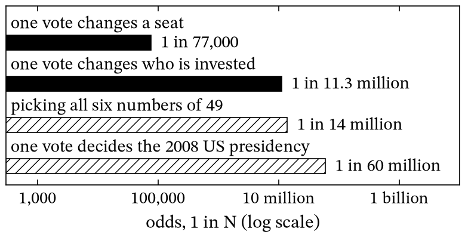
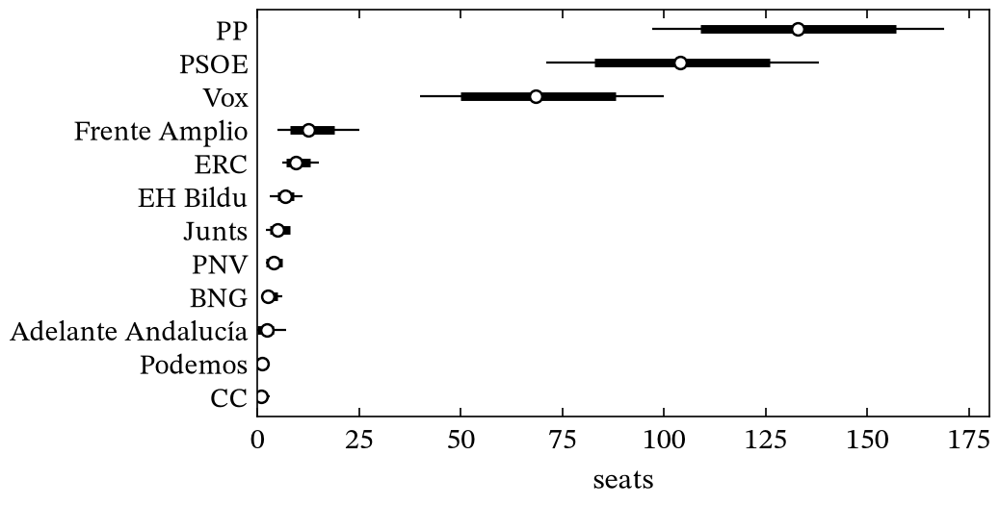
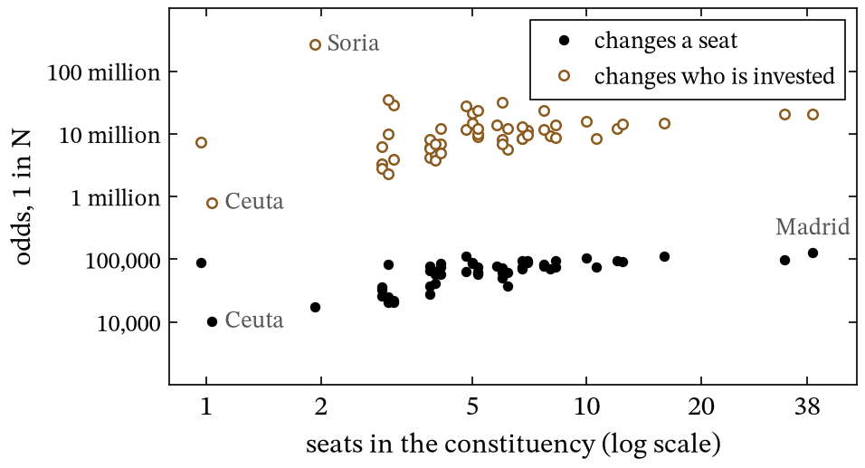
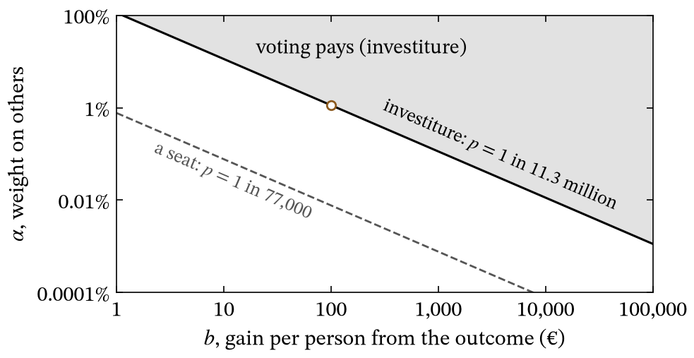

<!-- Written by `voteev texts` from src/spain_vote_ev/templates/README.md, with the numbers of results/summary.json. Edit the template, not this file. -->
# What is one vote worth? Spain, 29 November 2026

A seat simulation of Spain's general election of 29 November 2026, built to answer one
question: how likely is one more vote to change the result, a seat or who is invested prime
minister? Every list is treated alike, each list votes in the investiture as its group did in
2023, and nothing here advises anyone how, or whether, to vote.

Polls with fieldwork ending 27 October – 10 November 2026 (16 firms, 19 days before the election);
100,000 simulated elections (seed `20261129`).

| One more vote, for the average voter | Probability | 95% Monte Carlo interval |
|---|---:|---:|
| changes a seat | 1 in 77,000 | 1 in 76,000 – 77,000 |
| changes who is invested | 1 in 11.3 million | 1 in 10.8 million – 11.9 million |
| changes whether either 2023 investiture bloc reaches 176 seats | 1 in 11.2 million | 1 in 10.7 million – 11.8 million |

With every list voting as its group did in 2023, the PP's candidate is invested in
93.8% of the simulated elections, the PSOE's candidate in 4.6%, and nobody in
1.6% ([Who is invested](#who-is-invested)). Across the variants of
[What was checked](#what-was-checked), the PP's candidate is invested in 80.9% to 94.5% of
the runs.

For scale: picking all six numbers of 49 is 1 in 14 million (13,983,816 combinations),
and Gelman, Silver and Edlin (2012) put the chance that one vote decided the 2008 US presidency
at about 1 in 60 million for the average voter. One vote changing who is invested in Spain is
close to the odds of picking all six numbers of 49, and about 5 times likelier than deciding the 2008 US presidency.

The Monte Carlo intervals measure only simulation noise. The real uncertainty is in the model:
the bandwidth choice moves the answers by 0.3% (seat) and
0.7% (investiture), and [What was checked](#what-was-checked) shows what the
main assumptions do.



The carousel is a summary in paper form: [in Spanish](carousel/carousel.pdf) (the one posted;
[plain text](carousel/slides.txt)) and [in English](carousel/en/carousel.pdf)
([plain text](carousel/en/slides.txt)). [POST.md](POST.md) is the LinkedIn post.

## The question

Spain elects 350 deputies in 52 constituencies by D'Hondt, with a 3% threshold of valid votes
in each; Ceuta and Melilla elect one each. One more vote matters if it moves a seat from one
list to another, and more if that seat changes who is invested.

**The investiture.** Congress invests the prime minister (Constitution, art. 99; Reglamento del
Congreso, arts. 170–172). After consulting the groups, the King proposes a candidate through
the Speaker. The candidate is invested in a first vote with the absolute majority of the 350
deputies, 176 yes votes; if not, in a second vote 48 hours later, with more yes than no votes.
Further candidates may be proposed; if nobody is invested two months after the first vote, both
chambers are dissolved and a new election is called.

**How each list votes.** Two candidates are modelled: the PP's and the PSOE's. The base rule
takes each 2026 list's vote from its group's vote in the two investitures of the 2023
legislature, with no abstentions, as then:

- On the PP's candidate, as on Feijóo (27 September 2023): 172 yes (PP
  137, Vox 33, UPN 1, CC 1) and
  178 no.
- On the PSOE's candidate, as on Sánchez (16 November 2023): 179 yes (PSOE
  121, Sumar 31, ERC 7, Junts
  7, EH Bildu 6, PNV 5, BNG
  1, CC 1) and 171 no.

A 2026 list inherits the vote of the 2023 group it comes from: the PP's lists include UPN (the
UPN–PP list in Navarra), and Frente Amplio and Podemos sat in the Sumar group. Lists with no
seat in 2023 (SALF, Adelante Andalucía, Teruel Existe, Soria ¡Ya!) have no record: they vote no,
and in a variant they abstain. Coalición Canaria voted yes to both. With nobody abstaining, the
second vote also needs 176, so a candidate is invested exactly when its 2023 coalition holds 176
seats. If both candidates could be invested, which only happens when Coalición Canaria holds the
balance, the candidate of the larger party is proposed first, as in 2023, and a tie goes to the
PP's candidate: an assumption, needed in 0.01% of the runs. The totals are those of the
Diario de Sesiones
([27 Sep 2023](https://www.congreso.es/public_oficiales/L15/CONG/DS/PL/DSCD-15-PL-5.PDF),
[16 Nov 2023](https://www.congreso.es/public_oficiales/L15/CONG/DS/PL/DSCD-15-PL-8.PDF)).

**The record.** Votes change. Since 2016, Congress has voted 13 times in
7 investiture debates. The table adds the censure motion of 2018, the only one to
pass, which needs 176 yes votes and invests its candidate (Constitution, art. 113). Each vote
with the groups that voted yes or abstained (the others voted no, but for absences), from the
roll calls in the Diario de Sesiones
([data/curated/investitures.csv](data/curated/investitures.csv)):

| Date | Candidate | Vote | Yes | No | Abstained | Other | Invested | Yes votes | Abstentions | Diario de Sesiones |
| --- | --- | --- | ---: | ---: | ---: | ---: | --- | --- | --- | --- |
| 2 March 2016 | Sánchez (PSOE) | first | 130 | 219 | 1 | 0 | no | PSOE 89, Cs 40, NC 1 | CC 1 | [DSCD-11-PL-3](https://www.congreso.es/public_oficiales/L11/CONG/DS/PL/DSCD-11-PL-3.PDF) |
| 4 March 2016 | Sánchez (PSOE) | second | 131 | 219 | 0 | 0 | no | PSOE 89, Cs 40, CC 1, NC 1 | — | [DSCD-11-PL-4](https://www.congreso.es/public_oficiales/L11/CONG/DS/PL/DSCD-11-PL-4.PDF) |
| 31 August 2016 | Rajoy (PP) | first | 170 | 180 | 0 | 0 | no | PP 134, Cs 32, UPN 2, CC 1, Foro 1 | — | [DSCD-12-PL-4](https://www.congreso.es/public_oficiales/L12/CONG/DS/PL/DSCD-12-PL-4.PDF) |
| 2 September 2016 | Rajoy (PP) | second | 170 | 180 | 0 | 0 | no | PP 134, Cs 32, UPN 2, CC 1, Foro 1 | — | [DSCD-12-PL-5](https://www.congreso.es/public_oficiales/L12/CONG/DS/PL/DSCD-12-PL-5.PDF) |
| 27 October 2016 | Rajoy (PP) | first | 170 | 180 | 0 | 0 | no | PP 134, Cs 32, UPN 2, CC 1, Foro 1 | — | [DSCD-12-PL-13](https://www.congreso.es/public_oficiales/L12/CONG/DS/PL/DSCD-12-PL-13.PDF) |
| 29 October 2016 | Rajoy (PP) | second | 170 | 111 | 68 | 1 | yes | PP 134, Cs 32, UPN 2, CC 1, Foro 1 | PSOE 68 | [DSCD-12-PL-14](https://www.congreso.es/public_oficiales/L12/CONG/DS/PL/DSCD-12-PL-14.PDF) |
| 1 June 2018 | Sánchez (PSOE) | censure motion | 180 | 169 | 1 | 0 | yes | PSOE 84, Unidos Podemos 45, En Comú Podem 12, ERC 9, PDeCAT 8, En Marea 5, PNV 5, Podemos/EUPV 5, Compromís 4, EH Bildu 2, NC 1 | CC 1 | [DSCD-12-PL-127](https://www.congreso.es/public_oficiales/L12/CONG/DS/PL/DSCD-12-PL-127.PDF) |
| 23 July 2019 | Sánchez (PSOE) | first | 124 | 170 | 52 | 4 | no | PSOE 123, PRC 1 | Unidas Podemos 32, En Comú Podem 7, PNV 6, EH Bildu 4, En Común-UP 2, Compromís 1 | [DSCD-13-PL-3](https://www.congreso.es/public_oficiales/L13/CONG/DS/PL/DSCD-13-PL-3.PDF) |
| 25 July 2019 | Sánchez (PSOE) | second | 124 | 155 | 67 | 4 | no | PSOE 123, PRC 1 | Unidas Podemos 33, ERC 14, En Comú Podem 7, PNV 6, EH Bildu 4, En Común-UP 2, Compromís 1 | [DSCD-13-PL-5](https://www.congreso.es/public_oficiales/L13/CONG/DS/PL/DSCD-13-PL-5.PDF) |
| 5 January 2020 | Sánchez (PSOE) | first | 166 | 165 | 18 | 1 | no | PSOE 120, Unidas Podemos 26, En Comú Podem 6, PNV 6, En Común-UP 2, Más País 2, BNG 1, Compromís 1, NC 1, Teruel Existe 1 | ERC 13, EH Bildu 5 | [DSCD-14-PL-3](https://www.congreso.es/public_oficiales/L14/CONG/DS/PL/DSCD-14-PL-3.PDF) |
| 7 January 2020 | Sánchez (PSOE) | second | 167 | 165 | 18 | 0 | yes | PSOE 120, Unidas Podemos 26, En Comú Podem 7, PNV 6, En Común-UP 2, Más País 2, BNG 1, Compromís 1, NC 1, Teruel Existe 1 | ERC 13, EH Bildu 5 | [DSCD-14-PL-4](https://www.congreso.es/public_oficiales/L14/CONG/DS/PL/DSCD-14-PL-4.PDF) |
| 27 September 2023 | Feijóo (PP) | first | 172 | 178 | 0 | 0 | no | PP 137, Vox 33, CC 1, UPN 1 | — | [DSCD-15-PL-5](https://www.congreso.es/public_oficiales/L15/CONG/DS/PL/DSCD-15-PL-5.PDF) |
| 29 September 2023 | Feijóo (PP) | second | 172 | 177 | 0 | 1 | no | PP 137, Vox 33, CC 1, UPN 1 | — | [DSCD-15-PL-6](https://www.congreso.es/public_oficiales/L15/CONG/DS/PL/DSCD-15-PL-6.PDF) |
| 16 November 2023 | Sánchez (PSOE) | first | 179 | 171 | 0 | 0 | yes | PSOE 121, Sumar 31, ERC 7, Junts 7, EH Bildu 6, PNV 5, BNG 1, CC 1 | — | [DSCD-15-PL-8](https://www.congreso.es/public_oficiales/L15/CONG/DS/PL/DSCD-15-PL-8.PDF) |

Groups are the lists as elected, with their joint lists (the file's notes name each case).
"Other": absent, not called, a seat vacant that day, or a null vote (29 September 2023). In
October 2016 and January 2020, a candidate passed the second vote with fewer than 176 yes votes because
deputies abstained. In 2023 nobody abstained, which is where the base rule comes
from; its variant lets only the lists with no 2023 seat abstain, and no 2023 group changes
sides.

**The average voter.** Each constituency's probability for each list, averaged with weights
equal to the list's expected votes there: the chance for a vote picked at random from all the
votes cast for the modelled lists.

## Results

### Who is invested

| Candidate | Yes votes (mean) | 80% | Invested | In the first vote | Only in the second vote |
| --- | ---: | :---: | ---: | ---: | ---: |
| The PP's candidate | 202 | 180–225 | 93.8% | 93.8% | 0.0% |
| The PSOE's candidate | 146 | 124–168 | 4.6% | 4.6% | 0.0% |
| Nobody |  |  | 1.6% |  |  |

"Invested" adds both votes. Under the base rule nobody abstains, so the second vote needs 176
too and nobody is invested only in it. If the lists with no 2023 seat abstain instead, the PP's
candidate is invested in 94.5% of the runs
(0.7% only in the second vote), the PSOE's in
5.4% (0.8%), and nobody in
0.03%. "Nobody" means that neither candidate passes with the 2023
votes; the two months of talks that would follow are not simulated, so it is not a forecast of
a repeat election.

### Who holds the key

Seats are not power, and power has two readings here.

- **A priori power.** The Shapley–Shubik index (Shapley and Shubik, 1954) is the share of all
  orderings of the lists in which a list's seats are the ones that carry a growing coalition
  past 176; the Banzhaf index (Banzhaf, 1965) is the share of winning coalitions in which a list
  is decisive, normalised to sum to one. Both let any coalition form.
- **The key.** The probability that, with every list voting as in 2023, a list's votes are
  necessary for the investiture that happens: had it voted no instead of yes, the invested
  candidate would have lost both votes. Only the two coalitions of 2023 count.

| List | Mean seats | Shapley–Shubik | Banzhaf | Key: the PP's candidate | Key: the PSOE's candidate | Key: either |
| --- | ---: | ---: | ---: | ---: | ---: | ---: |
| PP | 133 | 38.4% | 38.1% | 94% | 0.0% | 94% |
| PSOE | 104 | 27.0% | 26.7% | 0.0% | 4.6% | 4.6% |
| Vox | 68 | 26.4% | 26.3% | 93% | 0.0% | 93% |
| Frente Amplio | 13 | 2.4% | 2.5% | 0.0% | 3.7% | 3.7% |
| ERC | 9 | 1.7% | 1.8% | 0.0% | 3.1% | 3.1% |
| EH Bildu | 7 | 1.2% | 1.4% | 0.0% | 2.5% | 2.5% |
| Junts | 5 | 0.9% | 1.0% | 0.0% | 2.0% | 2.0% |
| PNV | 4 | 0.7% | 0.8% | 0.0% | 1.6% | 1.6% |
| BNG | 3 | 0.4% | 0.5% | 0.0% | 1.2% | 1.2% |
| Adelante Andalucía | 2 | 0.4% | 0.5% | 0.0% | 0.0% | 0.0% |
| Podemos | 1 | 0.2% | 0.2% | 0.0% | 0.5% | 0.5% |
| CC | 1 | 0.2% | 0.2% | 0.7% | 0.5% | 1.2% |

Mean seats and a priori power are averaged over 10,000 simulated parliaments; the key
over all 100,000. A priori power, then and now:

The 2023 Congress:

| List | Seats | Seat share | Shapley–Shubik | Banzhaf |
| --- | ---: | ---: | ---: | ---: |
| PP | 137 | 39.1% | 40.6% | 41.5% |
| PSOE | 121 | 34.6% | 20.1% | 17.8% |
| Vox | 33 | 9.4% | 15.0% | 15.8% |
| Sumar | 31 | 8.9% | 12.3% | 13.8% |
| ERC | 7 | 2.0% | 3.1% | 2.8% |
| Junts | 7 | 2.0% | 3.1% | 2.8% |
| EH Bildu | 6 | 1.7% | 2.5% | 2.4% |
| PNV | 5 | 1.4% | 1.6% | 1.6% |
| BNG | 1 | 0.3% | 0.5% | 0.5% |
| CC | 1 | 0.3% | 0.5% | 0.5% |
| UPN | 1 | 0.3% | 0.5% | 0.5% |

Averaged over 10,000 simulated 2026 parliaments (lists with at least 0.1% of the seats):

| List | Mean seat share | Shapley–Shubik | Banzhaf |
| --- | ---: | ---: | ---: |
| PP | 38.0% | 38.4% | 38.1% |
| PSOE | 29.7% | 27.0% | 26.7% |
| Vox | 19.5% | 26.4% | 26.3% |
| Frente Amplio | 3.6% | 2.4% | 2.5% |
| ERC | 2.7% | 1.7% | 1.8% |
| EH Bildu | 2.0% | 1.2% | 1.4% |
| Junts | 1.4% | 0.9% | 1.0% |
| PNV | 1.1% | 0.7% | 0.8% |
| BNG | 0.7% | 0.4% | 0.5% |
| Adelante Andalucía | 0.7% | 0.4% | 0.5% |
| Podemos | 0.3% | 0.2% | 0.2% |
| CC | 0.3% | 0.2% | 0.2% |

### Blocs and lists

The coalitions of the two 2023 investitures, as blocs: F voted yes to Feijóo, S to Sánchez, and
S without Junts is reported too. A bloc with 176 seats is the base rule's investiture:

| Bloc | Mean seats | 80% | 95% | P(≥ 176) | One vote moves it across 176: 1 in |
| --- | ---: | :---: | :---: | ---: | ---: |
| F | 202 | 180–225 | 168–236 | 93.8% | 19.4 million |
| S | 146 | 124–168 | 112–181 | 4.6% | 23.8 million |
| S without Junts | 141 | 119–163 | 108–176 | 2.6% | 38.2 million |



| List | Vote share (centre) | Mean seats | 80% | 95% | P(at least one seat) |
| --- | ---: | ---: | :---: | :---: | ---: |
| PP | 32.1% | 133 | 109–157 | 97–169 | 100% |
| PSOE | 26.4% | 104 | 83–126 | 71–138 | 100% |
| Vox | 19.4% | 68 | 50–88 | 40–100 | 100% |
| Frente Amplio | 7.0% | 13 | 8–19 | 5–25 | 100% |
| ERC | 2.4% | 9 | 7–13 | 6–15 | 100% |
| EH Bildu | 1.4% | 7 | 5–9 | 3–11 | 100% |
| Junts | 1.4% | 5 | 3–8 | 2–8 | 100% |
| PNV | 0.91% | 4 | 2–6 | 2–6 | 100% |
| BNG | 0.91% | 3 | 2–5 | 1–6 | 98% |
| Adelante Andalucía | 1.4% | 2 | 0–4 | 0–7 | 86% |
| Podemos | 1.9% | 1 | 0–2 | 0–2 | 82% |
| CC | 0.40% | 1 | 1–1 | 0–3 | 91% |
| SALF | 1.7% | 0 | 0–0 | 0–1 | 6% |
| Soria ¡Ya! | 0.04% | 0 | 0–0 | 0–0 | 1% |
| Teruel Existe | 0.04% | 0 | 0–0 | 0–0 | 0.03% |

"Vote share (centre)" is the share the simulation is centred on: the poll median for polled
lists, rescaled with the unpolled lists and blank votes; Teruel Existe and Soria ¡Ya! keep
their 2023 share.

### Constituencies

Small constituencies weigh more per elector: 35,000 electors per seat in Teruel
against 150,000 in Madrid, 4.1 times as many. Across constituencies the
chance of changing a seat varies 12-fold, and the chance of changing who is
invested 330-fold: from 1 in 800,000 in
Ceuta to 1 in 268 million in Soria.



Every constituency, sorted by the chance of changing a seat:

| Constituency | Seats | Electors per seat | Seat: 1 in | Who is invested: 1 in | Either bloc to 176: 1 in | F: 1 in | S: 1 in |
| --- | ---: | ---: | ---: | ---: | ---: | ---: | ---: |
| Ceuta | 1 | 66,000 | 10,000 | 800,000 | 800,000 | 1.4 million | 1.7 million |
| Soria | 2 | 39,000 | 18,000 | 268 million | 268 million | 268 million | — |
| Ávila | 3 | 46,000 | 21,000 | 29.2 million | 29.2 million | 37.5 million | 131 million |
| Segovia | 3 | 40,000 | 21,000 | 10.1 million | 9.7 million | 14.6 million | 17 million |
| Teruel | 3 | 35,000 | 22,000 | 4.0 million | 3.9 million | 7.0 million | 7.6 million |
| Palencia | 3 | 46,000 | 25,000 | 2.3 million | 2.2 million | 3.6 million | 5.0 million |
| Zamora | 3 | 54,000 | 26,000 | 6.3 million | 6.2 million | 12.4 million | 11 million |
| Lleida | 4 | 82,000 | 28,000 | 8.2 million | 8.2 million | 16.6 million | 15.7 million |
| Huesca | 3 | 59,000 | 33,000 | 2.8 million | 2.8 million | 5.1 million | 5.8 million |
| Cuenca | 3 | 50,000 | 36,000 | 3.3 million | 3.3 million | 5.7 million | 6.8 million |
| Álava | 4 | 67,000 | 37,000 | 6.1 million | 6.1 million | 10.1 million | 14.1 million |
| Girona | 6 | 96,000 | 38,000 | 5.6 million | 5.6 million | 9.2 million | 11.7 million |
| La Rioja | 4 | 65,000 | 41,000 | 7.0 million | 7.0 million | 13.3 million | 13.7 million |
| Tarragona | 6 | 100,000 | 51,000 | 6.8 million | 6.8 million | 11.5 million | 14.8 million |
| Cáceres | 4 | 85,000 | 57,000 | 12.1 million | 11.7 million | 18.5 million | 27.2 million |
| Castellón | 5 | 90,000 | 58,000 | 9.0 million | 9.0 million | 15.7 million | 20.3 million |
| Burgos | 4 | 75,000 | 58,000 | 4.6 million | 4.6 million | 6.7 million | 12.7 million |
| Huelva | 5 | 82,000 | 61,000 | 10.1 million | 10.1 million | 14.9 million | 29 million |
| Gipuzkoa | 6 | 100,000 | 61,000 | 32 million | 32 million | 57.4 million | 68.1 million |
| Navarra | 5 | 110,000 | 62,000 | 11.9 million | 11.9 million | 22.6 million | 23.9 million |
| Almería | 6 | 90,000 | 62,000 | 12.1 million | 12.1 million | 20.3 million | 26.1 million |
| Lugo | 4 | 85,000 | 63,000 | 3.7 million | 3.7 million | 6.0 million | 8.9 million |
| Ciudad Real | 5 | 79,000 | 65,000 | 28 million | 28 million | 32.4 million | 204 million |
| Ourense | 4 | 90,000 | 66,000 | 5.8 million | 5.8 million | 8.2 million | 17.5 million |
| Baleares | 8 | 110,000 | 70,000 | 9.4 million | 9.2 million | 15.8 million | 19.8 million |
| S. C. Tenerife | 7 | 130,000 | 71,000 | 8.4 million | 8.4 million | 16 million | 16 million |
| Córdoba | 6 | 110,000 | 73,000 | 8.1 million | 8.1 million | 13.7 million | 15.6 million |
| Málaga | 11 | 120,000 | 74,000 | 8.4 million | 8.3 million | 15.2 million | 15.3 million |
| Las Palmas | 8 | 120,000 | 74,000 | 8.8 million | 8.8 million | 17.5 million | 16.7 million |
| León | 4 | 110,000 | 74,000 | 6.9 million | 6.9 million | 9.4 million | 23 million |
| Valladolid | 5 | 88,000 | 75,000 | 23.6 million | 23.6 million | 30.5 million | 78.9 million |
| Granada | 7 | 110,000 | 76,000 | 8.4 million | 8.3 million | 16.6 million | 16.1 million |
| Cádiz | 8 | 130,000 | 77,000 | 11.7 million | 11.3 million | 17.5 million | 28.3 million |
| Toledo | 6 | 95,000 | 77,000 | 13.9 million | 13.9 million | 24 million | 27.1 million |
| Albacete | 4 | 77,000 | 79,000 | 4.2 million | 4.2 million | 6.6 million | 10.3 million |
| Guadalajara | 3 | 70,000 | 82,000 | 35.5 million | 35.5 million | 123 million | 49.9 million |
| Bizkaia | 8 | 120,000 | 82,000 | 23.5 million | 23.5 million | 37.9 million | 52.8 million |
| Jaén | 5 | 100,000 | 85,000 | 14.9 million | 14.9 million | 32.2 million | 26.7 million |
| Salamanca | 4 | 76,000 | 86,000 | 5.0 million | 4.9 million | 9.9 million | 8.9 million |
| Cantabria | 5 | 100,000 | 88,000 | 21 million | 21 million | 42.5 million | 38.5 million |
| Zaragoza | 7 | 110,000 | 90,000 | 9.7 million | 9.7 million | 14.8 million | 21.2 million |
| Melilla | 1 | 64,000 | 90,000 | 7.4 million | 7.4 million | 16.2 million | 12.2 million |
| Sevilla | 12 | 130,000 | 93,000 | 14.4 million | 14.3 million | 22.5 million | 36.2 million |
| Alicante | 12 | 110,000 | 94,000 | 12.2 million | 12.2 million | 17 million | 38 million |
| A Coruña | 8 | 140,000 | 95,000 | 13.7 million | 13.7 million | 20.4 million | 32 million |
| Pontevedra | 7 | 130,000 | 96,000 | 13.1 million | 13.1 million | 20.7 million | 33.2 million |
| Asturias | 7 | 140,000 | 97,000 | 11.4 million | 11.1 million | 19.3 million | 24.8 million |
| Barcelona | 32 | 140,000 | 98,000 | 20.9 million | 20.6 million | 34.4 million | 49.1 million |
| Murcia | 10 | 110,000 | 100,000 | 15.6 million | 15.5 million | 35.9 million | 25.6 million |
| Valencia | 16 | 130,000 | 110,000 | 14.9 million | 14.9 million | 28.7 million | 28.1 million |
| Badajoz | 5 | 110,000 | 110,000 | 11.8 million | 11.5 million | 20.1 million | 24.4 million |
| Madrid | 38 | 150,000 | 130,000 | 20.4 million | 20 million | 46.5 million | 33.5 million |

"—": no such event in the runs. The investiture and bloc figures of a single constituency rest
on few simulated events and are noisy; the national figures above are precise.

The same numbers, with expected votes, are in
[results/provinces.csv](results/provinces.csv); simulated mean seats by constituency and list
are in [results/seats_by_province.csv](results/seats_by_province.csv).

### What was checked

**Inputs against the 2026 BOE.** The seats per constituency are those of the decree calling the
election, and the lists those proclaimed by the electoral boards. The PP and UPN run together in
Navarra (UPN–PP), counted as the PP's list; Frente Amplio and Podemos run apart, and the 2023
Sumar vote is split between them; SALF and Adelante Andalucía are polled and modelled; Teruel
Existe and Soria ¡Ya! stand again and keep their 2023 base. No CUP, PRC or Aliança Catalana
candidacy was proclaimed for the Congreso.

**Lists that could win a seat.** Of the 555 candidacies proclaimed,
195 are pooled as "others", which win no seat in the model. Matched by name to
every list that ran for the Congreso since 2015, 132 have a past result in the
same constituency, and none has reached, in its constituency, the smallest share that has won a seat there since 2015. The closest:

| Constituency | 2026 candidacy | Best past share | In | Smallest share that won a seat there |
| --- | --- | ---: | --- | ---: |
| Navarra | GEROA BAI (GBAI) | 8.7% | 2015 | 15.3% |
| León | PARTIDO REGIONALISTA DEL PAIS LEONES (PREPAL) | 0.5% | April 2019 | 13.0% |
| Álava | ESCAÑOS EN BLANCO PARA DEJAR ESCAÑOS VACÍOS (ESCAÑOS EN BLANCO) | 0.4% | 2023 | 14.0% |
| Zamora | PARTIDO REGIONALISTA DEL PAIS LEONES (PREPAL) | 0.4% | April 2019 | 16.9% |
| La Rioja | ESCAÑOS EN BLANCO PARA DEJAR ESCAÑOS VACIOS (ESCAÑOS EN BLANCO) | 0.3% | 2023 | 15.8% |
| Navarra | POR UN MUNDO MAS JUSTO (MUNDO+JUSTO) | 0.3% | April 2019 | 15.3% |
| S. C. Tenerife | FRENTE OBRERO (FO) | 0.3% | 2023 | 10.5% |
| Burgos | POR UN MUNDO MAS JUSTO (MUNDO+JUSTO) | 0.3% | November 2019 | 17.1% |
| Asturias | PARTIDO COMUNISTA DE LOS TRABAJADORES DE ESPAÑA (PCTE) | 0.3% | 2023 | 11.5% |
| Toledo | FRENTE OBRERO (FO) | 0.3% | 2023 | 13.6% |

Poll columns that fewer than 5 firms report: none.

**The forecast under other assumptions.** Redone with one thing changed at a time, each with
the same 100,000 simulated elections as the base (the same seed), so that only the change
differs:

| Variant | Firms | The PP's candidate | The PSOE's candidate | Nobody | Only in the second vote | One vote changes who: 1 in | Note |
| --- | ---: | ---: | ---: | ---: | ---: | ---: | --- |
| Base: median of each list across firms | 16 | 93.8% | 4.6% | 1.6% | 0.0% | 11.3 million |  |
| Mean weighted by sample size | 16 | 87.1% | 9.7% | 3.2% | 0.0% | 5.9 million |  |
| Each firm's latest poll in the last 7 days only | 13 | 93.3% | 4.7% | 1.9% | 0.0% | 10.8 million |  |
| Each firm's shares corrected by its 2023 error (house effect) | 16 | 80.9% | 16.1% | 3.0% | 0.0% | 4.8 million |  |
| Without the CIS |  |  |  |  |  |  | no CIS poll in the window |
| Without polls released by a party | 15 | 94.3% | 4.3% | 1.5% | 0.0% | 11.8 million | Vox |
| Normal national errors (no Student-t) | 16 | 94.2% | 4.2% | 1.6% | 0.0% | 10.8 million |  |
| Lists with no 2023 seat abstain instead of voting no | 16 | 94.5% | 5.4% | 0.03% | 1.6% | 19.4 million |  |

The largest change comes from each firm corrected by its 2023 error: the PP's candidate is invested in
80.9% of the runs instead of 93.8%, the PSOE's in 16.1% instead
of 4.6%. The house effects are each firm's miss in its last poll before the 2023
election, on the logit scale, added to its 2026 figures (13 of 16 firms had
such a poll; Frente Amplio and Podemos take Sumar's): the variant assumes each firm repeats its
2023 error. The weighted mean weights each firm's poll by its sample size.

## Why vote at all

With three or more options, no ranking rule meets all of Arrow's (1951) conditions, and
every non-dictatorial rule can reward voting against one's true ranking (Gibbard, 1973;
Satterthwaite, 1975). Spain's rule is given; the question is whether one vote is worth its
cost. In the calculus of voting (Riker and Ordeshook, 1968) a citizen votes when

    R = p·B − C + D > 0

with p the chance of being decisive, B the value of the outcome to the voter, C the cost of
voting and D the value of voting itself. Downs (1957) noted that p is tiny.

**Cost.** At 30 minutes and 10 €/h, C = 5 €.

**Selfish benefit.** With p = 1 in 11.3 million, who is invested would have to be
worth 56.5 million € to the voter to cover C; for a seat (p = 1 in 77,000),
380,000 €.

**Social benefit.** If B counts the effect on everyone (Edlin, Gelman and Kaplan, 2007),
B = N·b·α, with N = 49.9 million residents (INE, 1 October 2026, provisional), b the
average gain per person and α the weight the voter gives a stranger relative to themself. Then
p·N = 4.4 for the investiture: with b = 100 €, voting pays once α passes
1.1% (about 1 in 88); with b = 1,000 €, once
it passes 0.11%. For a seat, p·N = 650.



**Others' votes.** Persuasion has, on average, no measurable effect in US general elections
(Kalla and Broockman, 2018); in France's 2012 presidential election, door-to-door canvassing
moved vote shares in the precincts it covered without moving turnout (Pons, 2018). Getting
people to vote is the other lever. In Europe, door-to-door canvassing raises turnout by
0.78 points per voter reached (95% interval −0.16 to
1.71; 8 experiments pooled by Bhatti et al., 2019),
against 2.5 points in the US (71 experiments;
Green, McGrath and Aronow, 2013). The only Spanish experiment, in Murcia's 2011 local
election, found no turnout effect (Morales, Ramiro and Jiménez-Buedo, 2023). The only pace
measured in Europe is 7.2 minutes per opened door (Cantoni and Pons,
2021), taken here as the time of a pair of canvassers, which the paper leaves open. With
1.8 registered voters per Spanish household (INE), a canvasser
reaches about 7.5 voters an hour, so an hour yields about 0.06
extra voters, between 0 and 0.2. At 0.06, an hour
beats 10 €/h only if who is invested is worth 1.9 billion € to the
person spending it; at 0.2, 565 million €; at 0, never. On the social
reckoning above, the same hour is worth 0.06 to 0.2 votes' worth of p·N·b·α.

## Method

1. **Polls.** Each firm's latest poll with fieldwork ending in the 14 days to the cutoff, from
   the Wikipedia list of opinion polls (revision fixed in `results/summary.json`); the median
   share of each list across firms. No firm is excluded. A list counts as polled if at least
   5 firms report it; joint columns are summed. Unpolled lists and blank votes keep their base
   share and the polled shares are rescaled around them. Other aggregations are variants
   ([What was checked](#what-was-checked)).
2. **National error.** Each polled share moves on the logit scale by an error of scale
   σ = 0.22: the root mean square of the same median's errors 19 days before the
   2015, 2016, April 2019, November 2019 and 2023 elections (43 list-elections
   with at least 1%; centred on zero, no bias correction). For lists that won at least 10%,
   those errors were 2.7 points RMS and at most 6.0 points.
   Since σ is itself estimated from 43 errors, each simulated election draws its own scale, σ·√(df/χ²), with df = 43 degrees of freedom: the errors are Student-t. A rule written before the runs decided this ([Backtests](#backtests)). Past
   errors show no positive correlation within blocs, so none is added.
3. **Constituencies.** Proportional swing from 2023: each list's share in a constituency is its
   2023 share times its national ratio, times exp(δ), with δ the sum of a regional effect
   (σ = 0.11) and a constituency effect (σ = 0.07), both estimated from how
   974 provincial swings departed from national ones; then shares are raked to the
   national draw. Sumar's 2023 vote is split between Frente Amplio and Podemos by their 2024
   European ratio in each province; SALF starts from its 2024 European vote; Adelante
   Andalucía, which in 2023 stood only in Cádiz, from a flat share across the Andalusian
   constituencies where it stands.
4. **Turnout.** National and constituency logit errors (σ = 0.19 and 0.10)
   around 2023 turnout.
5. **Seats.** D'Hondt with the 3% threshold in every constituency
   ([dhondt.py](src/spain_vote_ev/dhondt.py); official seats since 2015 are reproduced
   exactly), and for each list Δ, the extra votes it needs for one more seat, and the list
   that would lose it.
6. **The investiture.** In each simulated election the yes and no votes on each candidate are
   sums of the lists' seats under the base rule, and art. 99 decides who is invested
   ([investiture.py](src/spain_vote_ev/investiture.py)).
7. **One more vote.** The chance that a vote is decisive is the density of Δ at zero,
   p ≈ N_h / (n·h), where N_h counts the n runs with 0 < Δ ≤ h and h is 2% of the
   constituency's votes per seat; bandwidths of 1% and 5% are reported in `summary.json`. For
   the investiture, a run counts when the seat that changes hands changes who is invested: the
   tallies are recomputed with one seat moved from the list that would lose it to the list
   that would win it. For a bloc, a run counts when that seat moves the bloc across 176.

The 2026 lists are the candidacies proclaimed in the BOE, labelled by name. Modelled: every
list that at least 5 firms poll, plus Teruel Existe and Soria ¡Ya!, local lists with a large
vote in their province in 2023. All other candidacies are pooled as "others", which keep
their 2023 share and win no seats here.

## Backtests

The same code, run 7 days before the November 2019 and 2023 elections and calibrated only on
earlier elections. The widening rule was committed before the first backtest ran
([backtest.py](src/spain_vote_ev/backtest.py)): widen every error, by the first factor of
1.00, 1.25, 1.50, 2.00 that passes, if fewer than 75% of the actual seat counts fall in their 80%
intervals, or fewer than 90% in their 95% intervals.

Result: 22 of 26 inside the 80% intervals and 24 of 26 inside the 95% ones: no widening
(factor 1.00).


| Election | List | Actual seats | 80% | 95% |
| --- | --- | ---: | :---: | :---: |
| Nov 2019 | PP | 91 | 75–113 | 66–122 |
| Nov 2019 | PSOE | 120 | 96–136 | 88–147 |
| Nov 2019 | Vox | 52 | 31–60 | 25–68 |
| Nov 2019 | Cs | 10 (outside 80%) | 12–30 | 9–38 |
| Nov 2019 | Unidas Podemos | 35 | 24–45 | 20–53 |
| Nov 2019 | Más País | 3 | 2–7 | 2–10 |
| Nov 2019 | ERC | 13 | 12–19 | 11–22 |
| Nov 2019 | Junts | 8 | 4–8 | 3–8 |
| Nov 2019 | PNV | 6 | 5–9 | 4–10 |
| Nov 2019 | EH Bildu | 5 | 2–5 | 2–6 |
| Nov 2019 | BNG | 1 (outside 95%) | 0–0 | 0–0 |
| Nov 2019 | CC | 2 | 1–3 | 1–3 |
| Nov 2019 | CUP | 2 | 2–5 | 1–6 |
| Nov 2019 | PRC | 1 | 0–1 | 0–1 |
| 2023 | PP | 138 | 123–162 | 113–173 |
| 2023 | PSOE | 121 | 90–127 | 81–138 |
| 2023 | Vox | 33 | 25–48 | 19–55 |
| 2023 | Sumar | 31 | 23–43 | 19–48 |
| 2023 | ERC | 7 | 6–10 | 5–12 |
| 2023 | Junts | 7 | 5–9 | 4–11 |
| 2023 | EH Bildu | 6 | 3–7 | 2–8 |
| 2023 | PNV | 5 | 4–7 | 3–9 |
| 2023 | BNG | 1 | 1–3 | 1–4 |
| 2023 | CC | 1 | 0–1 | 0–1 |
| 2023 | CUP | 0 (outside 80%) | 1–1 | 0–2 |
| 2023 | Teruel Existe | 0 (outside 95%) | 1–1 | 1–1 |

The coalitions: in 2023 the forecast gave Feijóo's 62% and Sánchez's
31% to reach 176; Feijóo's won 172 seats (30%
percentile of its simulated total) and Sánchez's 179
(76%). In November 2019 the coalition of PSOE, Unidas Podemos, PNV, Más País
and BNG had 17% and won 165 (61%).

**σ's own uncertainty.** A second rule, also written in
[backtest.py](src/spain_vote_ev/backtest.py) before its runs: use Student-t errors if, at the
publication lead (19 days) and pooled over four elections, they bring the coverage of
the 80% and 95% intervals closer to 80% and 95% than normal errors do, without moving it away
on November 2019 and 2023 together. Each backtest is calibrated on the elections before it;
2016, the first with an earlier election at that lead, borrows the later pairs for the swing
deviations, so it is not fully out of sample, and in April 2019 one seat went to a list not
modelled (PRC).

| Election | Cutoff | Firms | σ | Past errors | Normal: in 80% | Normal: in 95% | Student-t: in 80% | Student-t: in 95% |
| --- | --- | ---: | ---: | ---: | ---: | ---: | ---: | ---: |
| 2016 | 7 June 2016 | 13 | 0.21 | 8 | 9 of 9 | 9 of 9 | 9 of 9 | 9 of 9 |
| April 2019 | 9 April 2019 | 11 | 0.17 | 15 | 7 of 11 | 9 of 11 | 7 of 11 | 9 of 11 |
| November 2019 | 22 October 2019 | 12 | 0.19 | 24 | 11 of 14 | 12 of 14 | 11 of 14 | 13 of 14 |
| 2023 | 4 July 2023 | 15 | 0.22 | 35 | 9 of 12 | 11 of 12 | 9 of 12 | 11 of 12 |
| All four |  |  |  |  | 36 of 46 | 41 of 46 | 36 of 46 | 42 of 46 |

The Student-t coverage is closer to the targets, so Student-t errors are adopted. The misses at the 80% level,
with Student-t errors: 2016, none; April 2019, Unidas Podemos (42 vs 24–41), Junts (7 vs 3–6), CC (2 vs 0–1), COMPROMIS (1 vs 2–6);
November 2019, Vox (52 vs 17–44), Cs (10 vs 13–39), BNG (1 vs 0–0); 2023, BNG (1 vs 2–5), CUP (0 vs 1–2), Teruel Existe (0 vs 1–1).

## Polls

| List | Median (%) | Range across firms (%) | Firms |
| --- | ---: | :---: | ---: |
| PP | 31.8 | 28.1–33.1 | 16 |
| PSOE | 26.15 | 24.7–31.4 | 16 |
| Vox | 19.2 | 17.5–20.2 | 16 |
| Frente Amplio | 6.9 | 5–8.1 | 16 |
| Podemos | 1.85 | 1.2–3.1 | 16 |
| SALF | 1.7 | 0.4–2.6 | 13 |
| Adelante Andalucía | 1.4 | 1–2.3 | 11 |
| ERC | 2.4 | 1.9–2.9 | 11 |
| Junts | 1.4 | 1.2–1.8 | 11 |
| EH Bildu | 1.4 | 1.3–1.6 | 11 |
| PNV | 0.9 | 0.7–0.9 | 11 |
| BNG | 0.9 | 0.8–1.3 | 11 |
| CC | 0.4 | 0.3–0.5 | 10 |

The CIS is in the median whenever its latest poll falls in the window. Its latest poll in the
data ended fieldwork on 6 October 2026. Against the median of the 8 other firms with
fieldwork in the 14 days to that date:

| List | CIS (%) | Median of the other firms (%) | Difference (points) |
| --- | ---: | ---: | ---: |
| PP | 22.2 | 32.9 | −10.7 |
| PSOE | 34.0 | 26.3 | +7.7 |
| Vox | 17.1 | 18.5 | −1.4 |
| Podemos | 3.1 | 3.3 | −0.2 |
| ERC | 3.0 | 2.0 | +1.0 |
| Junts | 1.1 | 1.2 | −0.1 |
| EH Bildu | 1.6 | 1.4 | +0.2 |
| PNV | 0.6 | 1.0 | −0.4 |
| BNG | 0.9 | 0.9 | +0.0 |
| CC | 0.2 | 0.4 | −0.2 |

## Inventory: the variables

Every input that can change the answer, where it comes from, how it enters, and what happens
when it is varied. "Effect" is the PP's candidate's chance of being invested under the variant
(base: 93.8%); [What was checked](#what-was-checked) has the rest.

| Variable | Value | Source | How it enters | Range tested | Effect |
|---|---|---|---|---|---|
| Poll summary | median of 16 firms | Wikipedia lists of polls, at a recorded revision | each list's national centre | mean weighted by sample size | 87.1% |
| Poll window | each firm's latest poll in the 14 days to the cutoff | design | which polls count | the last 7 days | 93.3% |
| House effects | none | each firm's last poll before the 2023 election | added to the firm's 2026 figures | each firm repeats its 2023 error | 80.9% |
| The CIS | in the median when its poll is in the window | CIS barometers, via the same lists | like any firm | without it | as the base |
| Polls released by parties | included | Wikipedia lists | like any firm | without them | 94.3% |
| Lists modelled | polled by at least 5 firms, plus Teruel Existe and Soria ¡Ya! | BOE candidacies; polls | the rest pooled as "others", with no seats | every 2026 candidacy against past results | 0 flagged |
| National error | σ = 0.22, logit scale | the same median's past errors, 43 cases | Student-t, 43 degrees of freedom | normal errors | 94.2% |
| Widening factor | 1.00 | pre-declared backtests | multiplies every error | 1.00, 1.25, 1.50, 2.00 | none chosen |
| Regional and provincial deviations | σ = 0.11 and 0.07 | 974 past provincial swings | normal, logit scale | not varied | [Limits](#limits) |
| Turnout | σ = 0.19 national, 0.10 provincial | past turnout changes | normal around 2023 turnout | not varied | [Limits](#limits) |
| Swing | proportional from 2023 | BOE results; 2024 European vote | provincial share × national ratio | not varied | [Limits](#limits) |
| Seats | 350 in 52 constituencies | the 2026 decree | exact | — | — |
| Seat rule | D'Hondt, 3% threshold | LOREG art. 163 | exact | every official result since 2015 reproduced | — |
| Investiture votes | each list as its group in 2023 | Diario de Sesiones | yes or no on each candidate | lists with no 2023 seat abstain | 94.5% |
| Candidate order | the larger party's first | the 2023 precedent | only if both could pass | — | 0.01% of runs |
| Bandwidth h | 2% of the votes per seat | design | density of Δ at zero | 1% and 5% | the odds move 0.7% |
| Cost of voting | 30 minutes at 10 €/h | assumption | C = 5 € | — | the theory only |
| Canvassing yield | 0.06 voters per canvasser-hour | European experiments | the value of an hour | 0 to 0.2 | the theory only |
| Population | 49.9 million | INE | N in B = N·b·α | — | the theory only |

## Inventory: the players

Who can change the result, what they want, what they can do, and how the model takes them in.

| Player | Objective | Instruments | Channel | In the model |
|---|---|---|---|---|
| Voters | the outcome (B) and voting itself (D), at a cost (C) | vote, abstain, persuade or mobilise others | vote shares, turnout | the polls and their past errors; turnout noise; p is this study |
| Abstainers | the same, with D below C or B small | stay home, or vote if mobilised | turnout | turnout noise; canvassing in [Why vote at all](#why-vote-at-all) |
| Parties | votes, office and policy (Strøm, 1990) | lists, platforms, campaigns, pacts, investiture votes | vote shares; the investiture | the polls; the 2023 investiture votes and a variant |
| Leaders | the same, and their own office | candidacy, campaign, negotiation | vote shares; the investiture | through their party; not separately |
| The King (art. 99) | a government within the Constitution | proposes candidates after consulting the groups | who is proposed, and in what order | two candidates; the larger party's first if both could pass |
| The Congress Bureau and the Speaker | the chamber's procedure | the calendar of the investiture debate | timing | not modelled: timing does not change who can be invested |
| Junta Electoral Central and the provincial boards | a clean election under the LOREG | proclaim candidacies, rule on complaints, scrutinise | which lists run; the count | the proclaimed candidacies; counts taken as exact |
| Poll workers | count the votes | the count at each table | the count | taken as exact |
| Pollsters | accuracy, attention, clients | publish estimates, never in the last five days (LOREG art. 69.7) | expectations, maybe votes | the median and its past errors; house effects as a variant |
| The CIS | the same, as a public body | monthly barometers | expectations | in the median when in the window; a variant without it |
| Media | audience, influence | coverage, framing | expectations, vote shares | through the polls and their past errors |
| Platforms | engagement, revenue | ranking, ads, moderation | vote shares, turnout | through the polls' past errors |
| Foreign disinformation | division, lower trust | false content, amplification | vote shares, turnout | the same; an effect larger than in 2015–2023 is not covered |
| Unions and employers | their members' interests | endorsements, campaigns, mobilisation | vote shares, turnout | through the polls |
| Regional governments | their region and party | agenda, regional campaigns | vote shares by region | the regional deviations |
| The EU and markets | fiscal rules, stability | rules, spreads | what any government can do | not in the vote: an outside constraint |

**Why the list is complete enough.** A player can change who is invested only through four
channels: which lists run, how many people vote and for which list, how votes become seats, and
how deputies vote in the investiture. The first is fixed by the proclaimed candidacies and
checked above. The second is the poll error, the regional and provincial deviations and the
turnout noise, all sized on 2015–2023, so they already contain what campaigns, media, platforms
and outside interference did in those years. The third is the law, applied exactly. The fourth
is the 2023 rule and its variant. A player missing from the table still acts through one of
these channels. What the model cannot cover is an effect larger than any in 2015–2023, such as
a shock in the last days, or investiture votes unlike 2023's, such as a new pact: both are in
[Limits](#limits).

## Data

All files are downloaded by `voteev download` into `data/raw/`, with a SHA-256 manifest
([data/raw/MANIFEST.tsv](data/raw/MANIFEST.tsv)); nothing else touches the network.

- Official results, Congreso 2015 to 2023: the Junta Electoral Central's publications of the
  general count in the BOE
  ([2015](https://www.boe.es/diario_boe/xml.php?id=BOE-A-2016-867),
  [2016](https://www.boe.es/boe/dias/2016/07/22/pdfs/BOE-A-2016-7133.pdf),
  [April 2019](https://www.boe.es/diario_boe/xml.php?id=BOE-A-2019-8070),
  [November 2019](https://www.boe.es/boe/dias/2019/12/02/pdfs/BOE-A-2019-17344.pdf) and its
  [tables](https://www.boe.es/diario_boe/xml.php?id=BOE-A-2019-18147),
  [2023](https://www.boe.es/diario_boe/xml.php?id=BOE-A-2023-18907)).
- European Parliament 2024 by province
  ([BOE-A-2024-13092](https://www.boe.es/diario_boe/xml.php?id=BOE-A-2024-13092), corrected by
  [BOE-A-2024-15344](https://www.boe.es/diario_boe/xml.php?id=BOE-A-2024-15344)).
- 2026: the decree calling the election, with the seats per constituency
  ([BOE-A-2026-20742](https://www.boe.es/diario_boe/xml.php?id=BOE-A-2026-20742)); the
  proclaimed candidacies
  ([BOE-A-2026-23103](https://www.boe.es/diario_boe/xml.php?id=BOE-A-2026-23103), corrected
  by [BOE-A-2026-23383](https://www.boe.es/diario_boe/xml.php?id=BOE-A-2026-23383)); electors
  per constituency ([INE](https://www.ine.es/dyngs/Prensa/EG2026.pdf)); population
  ([INE](https://www.ine.es/dyngs/Prensa/ECP3T26.pdf)).
- Polls: the English Wikipedia lists of opinion polls for each election, read through the
  MediaWiki API at a recorded revision.
- The 2023 investiture votes, which the base rule repeats: the Diario de Sesiones of
  [27 September](https://www.congreso.es/public_oficiales/L15/CONG/DS/PL/DSCD-15-PL-5.PDF) and
  [16 November 2023](https://www.congreso.es/public_oficiales/L15/CONG/DS/PL/DSCD-15-PL-8.PDF),
  downloaded with the rest.
- Investiture votes since 2016: [data/curated/investitures.csv](data/curated/investitures.csv),
  transcribed from the roll call of each vote in the Diario de Sesiones del Congreso (the URL
  is on every row); each vote's group totals add up to 350 and match the result announced in
  the chamber. The Senate's seats, rule and designated senators:
  [data/curated/senate.json](data/curated/senate.json), with its sources.
- The Ministry of the Interior's results archive (infoelectoral) is not used: its download
  area sits behind a browser check that a script cannot pass, and the BOE holds the same
  counts.

## Limits

- **Polls 19 days out.** The errors are sized for that lead, but campaigns can move more.
- **Proportional swing.** Lists are assumed to gain or lose in proportion to their 2023 vote
  everywhere, plus noise. Where a list's base is thin or missing (SALF, Adelante Andalucía, the
  split of Sumar), the starting point is a guess.
- **Local lists.** Teruel Existe and Soria ¡Ya! are not in national polls; they keep their 2023
  share with constituency noise only. Other local lists are pooled as "others" and win no seat,
  which the completeness check supports but cannot guarantee: a new list has no past result.
- **The investiture repeats 2023.** Parties can change sides, make new pacts or abstain, as the
  record above shows; the base rule allows none of it, and the variant only lets the lists with
  no 2023 seat abstain. Only the PP's and the PSOE's candidates are modelled.
- **σ's own uncertainty.** Errors of the same election move together, so the
  43 past errors are worth fewer independent ones. The Student-t with 43 degrees of freedom still counts them as independent, so the tails may be somewhat heavier than modelled. With
  normal errors, the PP's candidate is invested in 94.2% of the runs instead of
  93.8%.
- **House effects.** The variant assumes each firm repeats its 2023 error; firms change their
  methods, so it is a sensitivity, not a correction.
- **Independence.** Errors are independent across lists except for the rescaling that keeps
  shares summing to one.
- **The Senate is left out.** On 29 November, 209 senators are elected
  directly, one more than in 2023, since Ibiza and Formentera now elect one each
  ([the decree calling the election, art. 3.2](https://www.boe.es/diario_boe/txt.php?id=BOE-A-2026-20742)).
  A province elects four and its voters mark up to three candidates; Gran Canaria, Mallorca and
  Tenerife elect three, with two marks; Ceuta and Melilla two, with two; the other islands one.
  The most voted are elected (LOREG art. 166). On the 2023 count, that rule picks
  all 208 elected senators from 1,152
  candidates. What is not validated is the step a model fed by Congreso polls needs: from a
  list's Congreso vote to its candidates' Senate votes. Giving each 2023 candidate outside the
  islands their list's Congreso vote changes 7 of those
  192 seats (Badajoz, Barcelona, Cáceres, Gipuzkoa, Huelva, Navarra and Valencia): candidates of one list
  draw different votes, and some lists do better in the Senate than in the Congreso. The
  regional parliaments designate the other senators (Constitution, art. 69.5):
  58 at the dissolution, in a Senate of
  266 with an absolute majority of
  134
  ([Senado](https://www.senado.es/web/composicionorganizacion/senadores/composicionsenado/modificacionescomposicion/designadosca/index.html)),
  a number that can change with the population. So the Senate's majority and its pivot are
  left out too. These figures come from a one-off check on 12 November 2026, not from the
  pipeline ([data/curated/senate.json](data/curated/senate.json)).
- **The count.** Counting errors and challenges are left out; recounts move few votes.
- **Not a forecast of government.** Who is invested follows from the 2023 votes; the power
  indices and the key are arithmetic, not predictions of who will govern.

## Reproduce

Requires [uv](https://docs.astral.sh/uv/). From the repository root, one command refetches the
polls and rebuilds everything, ending with the check:

```bash
uv run voteev all                  # --keep-polls: no refetch; --cutoff YYYY-MM-DD: older polls
```

Step by step, the same:

```bash
uv sync
uv run voteev download    # fetch the sources (polls are refetched each time)
uv run voteev prepare     # parse them into data/processed/
uv run voteev analyze     # backtests, the 2026 simulation and its variants: results/summary.json
uv run voteev figures     # figures/*.png
uv run voteev carousel    # in Spanish: carousel/carousel.pdf, slide-NN.png, slides.txt
uv run voteev carousel --lang en   # in English, in carousel/en/ (and the README's figures)
uv run voteev texts       # README.md and POST.md from their templates
uv run voteev check       # every number in the texts is in summary.json; no gaping lines
uv run pytest && uv run ruff check
```

The `Makefile` runs the same steps (`make all`, with `CUTOFF=YYYY-MM-DD` if wanted). `results/summary.json` is the only source of
the numbers in this README, the carousels and the post: README.md and POST.md are written from
templates in `src/spain_vote_ev/templates/`, so a rerun with new polls rewrites every number
and every word that depends on one. `voteev check` fails if a number in them is not in
summary.json, or is not written in its language's format (`76,000` and `94.2%` in English;
`76.000` and `94,2 %` in Spanish, with a no-break space before % and €), or if a justified line
of a carousel has a gap wider than twice a space; a page where justifying would leave one is
set ragged-right.

Fonts: STIX Two (SIL Open Font License, in `src/spain_vote_ev/fonts/`).

## Neutrality

The model treats every list with the same rules. Investiture votes come from recorded votes, not
from judgement. Figures use black, greys and one brown accent, never party colours. Nothing here
says how, or whether, anyone should vote; the numbers describe how much one vote can move a
seat or who is invested.

## References

- Arrow, K. J. (1951). *Social Choice and Individual Values*. Wiley.
- Banzhaf, J. F. (1965). Weighted voting doesn't work. *Rutgers Law Review* 19(2), 317–343.
- Bhatti, Y., Dahlgaard, J. O., Hansen, J. H., & Hansen, K. M. (2019). Is door-to-door
  canvassing effective in Europe? Evidence from a meta-study across six European countries.
  *British Journal of Political Science* 49(1), 279–290.
  [doi:10.1017/S0007123416000521](https://doi.org/10.1017/S0007123416000521)
- Cantoni, E., & Pons, V. (2021). Do interactions with candidates increase voter support and
  participation? Experimental evidence from Italy. *Economics & Politics* 33(2), 379–402.
  [doi:10.1111/ecpo.12167](https://doi.org/10.1111/ecpo.12167)
- Downs, A. (1957). *An Economic Theory of Democracy*. Harper.
- Edlin, A., Gelman, A., & Kaplan, N. (2007). Voting as a rational choice. *Rationality and
  Society* 19(3), 293–314.
- Gelman, A., Silver, N., & Edlin, A. (2012). What is the probability your vote will make a
  difference? *Economic Inquiry* 50(2), 321–326.
- Gibbard, A. (1973). Manipulation of voting schemes. *Econometrica* 41(4), 587–601.
- Green, D. P., McGrath, M. C., & Aronow, P. M. (2013). Field experiments and the study of voter
  turnout. *Journal of Elections, Public Opinion and Parties* 23(1), 27–48.
  [doi:10.1080/17457289.2012.728223](https://doi.org/10.1080/17457289.2012.728223)
- Kalla, J. L., & Broockman, D. E. (2018). The minimal persuasive effects of campaign contact
  in general elections. *American Political Science Review* 112(1), 148–166.
- Morales, L., Ramiro, L., & Jiménez-Buedo, M. (2023). Assessing the electoral payoffs of
  partisan mobilization in adverse contexts: a field experimental study of the 2011 Spanish
  local elections. In T. Faas et al. (Eds.), *Informationsflüsse, Wahlen und Demokratie*,
  213–246. Nomos. [doi:10.5771/9783748915553-213](https://doi.org/10.5771/9783748915553-213)
- Pons, V. (2018). Will a five-minute discussion change your mind? A countrywide experiment on
  voter choice in France. *American Economic Review* 108(6), 1322–1363.
  [doi:10.1257/aer.20160524](https://doi.org/10.1257/aer.20160524)
- Riker, W. H., & Ordeshook, P. C. (1968). A theory of the calculus of voting. *American
  Political Science Review* 62(1), 25–42.
- Satterthwaite, M. A. (1975). Strategy-proofness and Arrow's conditions. *Journal of Economic
  Theory* 10(2), 187–217.
- Shapley, L. S., & Shubik, M. (1954). A method for evaluating the distribution of power in a
  committee system. *American Political Science Review* 48(3), 787–792.
- Strøm, K. (1990). A behavioral theory of competitive political parties. *American Journal of
  Political Science* 34(2), 565–598.
